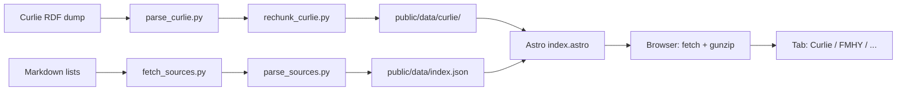

<div align="center">

# HumanWeb

**A human-curated map of the web — thirteen directories, one tab each.**

[](https://adineo-cmd.github.io/HumanWeb/)
   

[](https://github.com/adineo-cmd/HumanWeb/stargazers) [](https://github.com/adineo-cmd/HumanWeb/commits)

[Live site](https://adineo-cmd.github.io/HumanWeb/) · [Quick start](#quick-start) · [How it works](#how-it-works) · [Features](#features)

</div>

---

Thirteen hand-curated web directories, kept **separate on purpose**. Every tab
loads only its own files from `public/data/<source>/`, so a machine-extracted
sample can never be mistaken for a human-vetted list.

The Curlie tab alone carries **2,619,031 links across 771,288 categories**, split
into 767 lazy-loaded chunk files. Across all thirteen sources the app indexes
**2,660,351 links**.

## Features

| | Feature | What it does |
| --- | --- | --- |
| 🗂️ | **Thirteen sources** | Curlie, FMHY, Awesome, Self-Hosted, Free for Dev, VLib, Public APIs, Dev Books, Build Your Own X, Privacy Tools, Useful Sites, OpenWebSearch and Common Crawl. |
| 🌳 | **Curlie tree** | A 0.1 MB tree index loads instantly; clicking a category lazy-loads one chunk file. |
| 🔗 | **Deep links** | Every Curlie category is addressable, e.g. `#curlie/Arts/Animation/Anime`. |
| 📴 | **No server** | Data is fetched and gunzipped in the browser with `DecompressionStream`, so any static host works. |
| 🧭 | **Per-tab search** | Whole-source tabs load once, then search and filter entirely on the client. |
| 🚫 | **Content policy** | The entire Adult tree and any category whose path contains "anime" are excluded, in every source. |

## How it works

The site is a static Astro shell over pre-built data:

1. `scripts/parse_curlie.py` walks the official RDF dump and writes one chunk per
   second-level category, recursively split when a chunk gets large.
2. `scripts/rechunk_curlie.py` re-cuts those chunks for the web UI and writes
   `public/data/curlie/`.
3. `scripts/fetch_sources.py` and `parse_sources.py` download and normalise the
   Markdown lists; `make_sources_index.py` writes `public/data/index.json`.
4. `src/pages/index.astro` renders the tabs; each tab fetches only its own
   directory and decompresses it in the browser.

Every run writes verification numbers — records parsed, duplicates dropped,
excluded adult and anime counts, unknown ids — to
`data-reports/curlie_report.json`.



## Quick start

Node 22.12+ for the site. Python 3.10+ for the data pipeline.

**Site**

```bash
npm install
npm run dev        # http://localhost:4321
npm run build      # static output in dist/
```

**Curlie pipeline**

```bash
# 1. download the official dump (see https://curlie.org/download)
curl -LO https://share.innkube.fim.uni-passau.de/curlie-rdf/curlie-rdf-all.tar.gz
mkdir -p ~/curlie_data/extracted
tar -xzf curlie-rdf-all.tar.gz -C ~/curlie_data/extracted

# 2. extract, then re-chunk for the UI
python3 scripts/parse_curlie.py ~/curlie_data/extracted/curlie-rdf
python3 scripts/rechunk_curlie.py
```

**Other sources**

```bash
python3 scripts/fetch_sources.py
python3 scripts/parse_sources.py
python3 scripts/make_sources_index.py
```

## Project structure

```text
src/pages/index.astro   the whole UI: tabs, tree, search
src/layouts/            shared document shell
src/styles/             global CSS
public/data/            one directory per source
  curlie/               tree index + 767 category chunks
  <source>/             data.json.gz + meta.json
scripts/                fetch, parse, re-chunk, index
sources_raw/            raw copies kept for provenance
data-reports/           verification output per run
```

## The thirteen sources

| Tab | Links | Shape |
| --- | --- | --- |
| Curlie | 2,619,031 | Full directory tree, adult & anime excluded |
| FMHY | 23,849 | 24 pages, 979 sections |
| Self-Hosted | 2,905 | awesome-selfhosted |
| Awesome | 2,677 | sindresorhus/awesome plus tagged lists |
| VLib | 2,585 | The WWW Virtual Library, est. 1991 |
| Dev Books | 2,451 | free-programming-books |
| Public APIs | 2,226 | public-apis |
| Free for Dev | 1,407 | SaaS free tiers |
| Common Crawl | 957 | A live machine-extracted sample — CC-MAIN-2026-43 |
| Privacy Tools | 700 | awesome-privacy |
| Useful Sites | 674 | Best websites a programmer should visit |
| OpenWebSearch | 534 | Europe's open web index |
| Build Your Own X | 355 | Step-by-step build guides |

Common Crawl is the one source that is **not** human-curated, and the interface
says so in its subtitle. It is included as a sample of the open crawl, not as a
directory.

## Licences

Each source keeps its own licence, shown in the site footer: the Curlie Directory
License, FMHY community terms, CC0 for Awesome, CC-BY-SA for Self-Hosted,
contributor copyright for free-for-dev, and © The WWW Virtual Library. Raw
fetched copies live in `sources_raw/` for provenance.

## Contributing

Issues and pull requests are welcome. For anything larger than a typo or a
small fix, open an issue first so the approach can be agreed before the work.

- Bugs and ideas: [issues](https://github.com/adineo-cmd/HumanWeb/issues)
